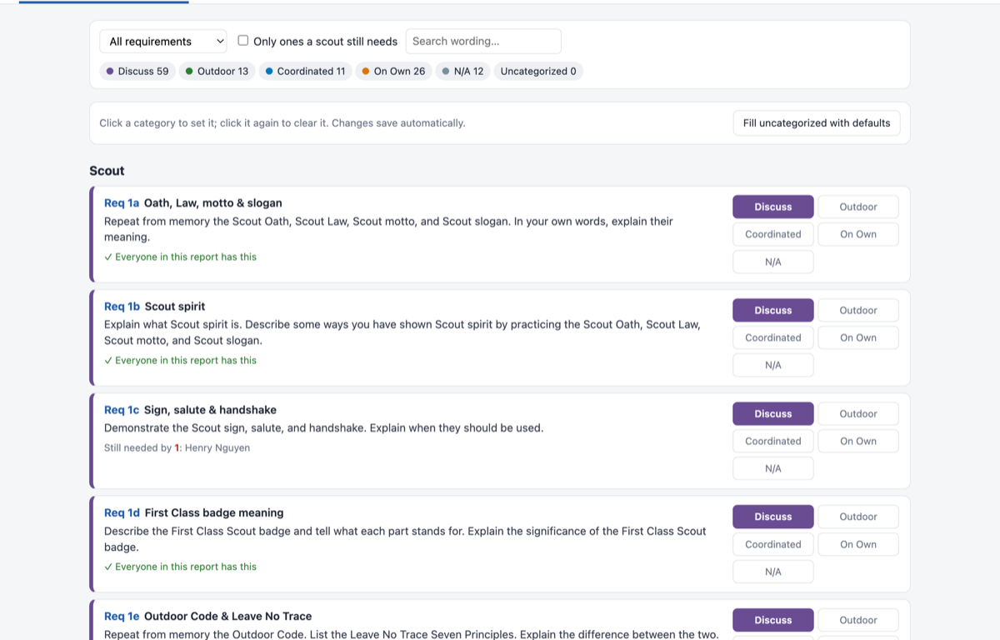
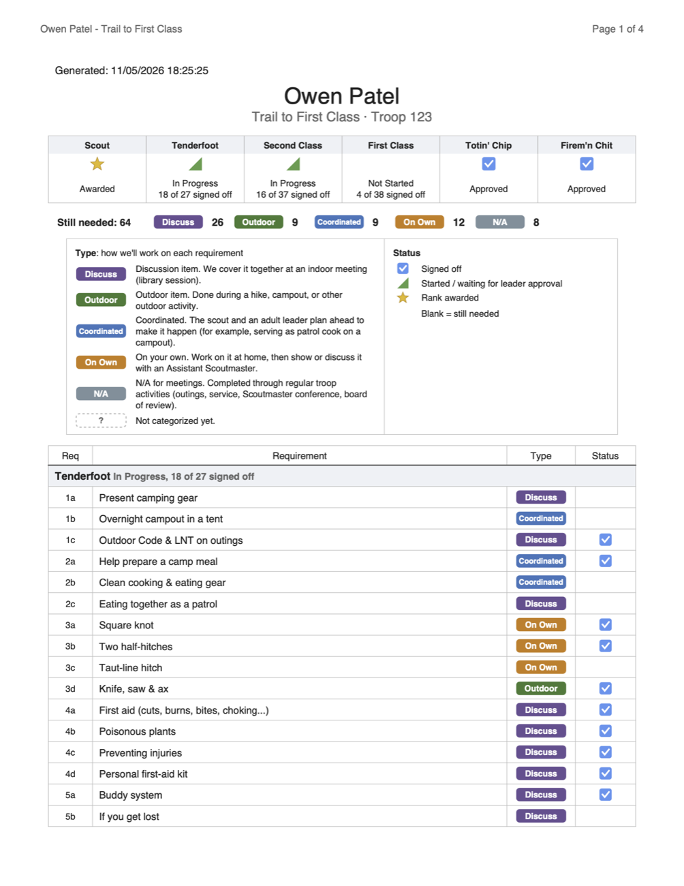

# Scout Advancement Tool

A small app for Windows and Mac for planning Scouts BSA advancement from Scout rank through First Class, plus Totin' Chip and Firem'n Chit. It reads the Report Builder CSV export from [advancements.scouting.org](https://advancements.scouting.org), lets you sort every requirement by how the troop will cover it, and prints PDF progress reports.

The tool runs on your own computer and opens in your web browser. Your scout data stays on your computer.



## What it does

- **Categorize requirements.** Shows the full official wording of every requirement. You tag each one as:
  - **Discuss**: covered together at an indoor meeting (library session)
  - **Outdoor**: done during a hike, campout, or other outdoor activity
  - **Coordinated**: the scout and an adult leader plan ahead to make it happen (for example, serving as patrol cook on a campout)
  - **On Own**: the scout works on it at home, then shows or discusses it with an ASM
  - **N/A**: happens through the regular troop program (outings, service, Scoutmaster conference, board of review)

  A new install starts with a default category for every requirement. You can change the tags at any time. Each requirement also shows which scouts still need it.
- **Scout progress.** Shows each scout's rank and chit status and how many items they have left in each category.
- **PDF reports.** Each run creates a folder named with the date and time (for example, `Reports/2026-11-03 16-44-31/`) containing:
  - one all-scouts grid, styled after the advancements.scouting.org report
  - a "remaining by type" grid: every requirement at least one scout still needs, grouped into Discuss, Outdoor, Coordinated, On Own, and N/A
  - one PDF per scout, to email to the scout and parents

  Each report starts at the scout's first unfinished rank. The PDFs show short requirement labels plus a legend; the full wording appears only in the app.

  

## Using the tool

1. Install it and open it. See [Windows](#windows) or [macOS](#macos) below.
2. The tool opens in your web browser. Click **Load CSV…** and pick the CSV file you exported from advancements.scouting.org. See [Getting your CSV](#getting-your-csv-from-advancementsscoutingorg) below.
3. **Tab 1 · Categorize:** check or change how each requirement will be covered.
4. **Tab 2 · Scout Progress:** see where each scout stands.
5. **Tab 3 · Generate PDFs:** pick the scouts and reports you want, then click **Generate PDFs**. The new folder of PDFs opens when it's done.
6. Click **Quit** in the page when you're finished. The tool keeps running in the background until you do. If you close the browser tab instead, opening the tool again brings the page back.

### Getting your CSV from advancements.scouting.org

The tool reads a CSV file exported from **Scoutbook Plus** at [advancements.scouting.org](https://advancements.scouting.org). You set up a custom report once, and then rerun it whenever you want fresh data.

**Set up the report (one time)**

1. Sign in at advancements.scouting.org and click **Reports** in the left menu.
2. Open the **Custom Reports** tab, then **My Reports**, and click **+ New Report**. This opens Scoutbook's Report Builder.
3. Under **Settings**, check only **Show Empty Requirements** and leave every other box unchecked. That makes the report list every requirement, even ones no scout has started, so the tool can show what's still left.
4. Under **Selections**, check the scouts you want to plan for: the whole unit, a patrol, or individual scouts.
5. Under **Ranks**, check both **Rank Status** and the requirements for each of these four ranks. Leave Star, Life and Eagle unchecked.

   | Rank | Check |
   | --- | --- |
   | Scout Rank | Rank Status, Scout Requirements |
   | Tenderfoot Rank | Rank Status, Tenderfoot Requirements |
   | Second Class Rank | Rank Status, Second Class Req. |
   | First Class Rank | Rank Status, First Class Requirements |

6. Under **Awards**, leave **Award Requirements** unchecked. Under **Multi-Program Awards**, check only **Firem'n Chit (Scouts BSA)**, **Totin' Chip**, and **Totin' Chip (2024)**.
7. Give the report a title (for example, "Trail to First Class") and save it.

**Export the CSV (each time you want fresh data)**

1. Go to **Reports → Custom Reports → My Reports**.
2. Find your saved report and click its green **Run** button.
3. On the report page, click the blue **CSV** button. The file downloads, usually to your Downloads folder.
4. In Scout Advancement Tool, click **Load CSV…** and pick that file. The report title on the PDFs comes from the file name, and you can change it on the **Generate PDFs** tab.

### Where your data lives

Your CSV, your categories and your reports are kept in a **Scout Advancement Data** folder in your Documents folder:

- `Data/current.csv`: the last CSV you loaded
- `Data/settings.json`: your requirement categories, report title, and legend wording
- `Reports/<date time>/`: the generated PDFs

To use a different folder, for example a shared or external drive, see [config.json](#choosing-the-data-folder-configjson) below.

### How the CSV is read

- A rank counts as **finished** when the report shows it as *Approved* or *Awarded*.
- A rank missing from the CSV (for example, Scout) is assumed finished if a later rank is present.
- Rows for other ranks or awards are ignored.
- Totin' Chip and Firem'n Chit are tracked as a whole. If either Totin' Chip version is approved, the chit counts as earned.

Requirement text comes from the official Scouts BSA rank requirements (effective Jan. 1, 2024) and the scouting.org Awards Central pages.

### Found a problem or have an idea?

Use the **[Scout Advancement Tool Feedback portal](https://alindeman51.atlassian.net/servicedesk/customer/portal/1)**. Choose **Report a problem** or **Suggest an improvement**. Please don't include scouts' names or attach your CSV file.

## Windows

### Install

1. Download **`ScoutAdvancementTool-<version>-Windows-Setup.exe`** from the [Releases](../../releases) page.
2. Run it. It installs for your Windows account only, so no administrator password is needed. Python and the PDF library are built in, so nothing else needs to be installed.
3. The installer isn't code-signed, so Windows may say *"Windows protected your PC."* Click **More info → Run anyway**.
4. Open **Scout Advancement Tool** from the Start menu.

There's also a portable `ScoutAdvancementTool-<version>-Windows-Portable.zip` that runs without installing. Unzip it and open `Scout Advancement Tool.exe`.

### Good to know

- Data and reports go in `Documents\Scout Advancement Data`. Uninstalling the tool leaves them in place.
- Problems are logged to `%LOCALAPPDATA%\Scout Advancement Tool\log.txt`.
- To update, run the newer installer. Your data and categories are kept.

## macOS

### Install

1. Download **`Scout-Advancement-Tool-<version>.dmg`** from the [Releases](../../releases) page, open it, and drag **Scout Advancement Tool** into **Applications**.
2. Open it from Launchpad, Spotlight, or the Applications folder. The app isn't signed with an Apple Developer ID, so the first time macOS blocks it. Go to **System Settings → Privacy & Security**, scroll down, click **Open Anyway** next to Scout Advancement Tool, and confirm.
3. The app uses the Python 3 that comes with Apple's free Command Line Developer Tools. If macOS offers to install them, click **Install**, wait for it to finish, then open the app again.

It works on Apple silicon and Intel Macs running macOS 12 or later.

### Good to know

- Data and reports go in `~/Documents/Scout Advancement Data`.
- Problems are logged to `~/Library/Logs/Scout Advancement Tool.log`.
- The app has no Dock icon or window of its own. It runs in the background while the browser page is open. Click **Quit** in the page to stop it.

### Running from a copy of this repo

If you've cloned the repo instead of downloading the app:

- **Double-click `Start Scout Tool.command`.** The first run installs the PDF library ([reportlab](https://www.reportlab.com/)) into `app/vendor/`, which needs internet access and only happens once. Leave the Terminal window open while you use the tool.
- **Or add it to Launchpad and Spotlight:** run `tools/install_app.sh` once. It builds **Scout Advancement Tool.app** in `~/Applications`, which runs the code in the repo with no Terminal window. Re-run the script only if the repo moves. If the repo is on an external drive, macOS asks the first time to let the app access it. Click **Allow**. The app uses a small compiled launcher (`tools/launcher.c`) instead of a shell script, so that macOS asks on behalf of the app instead of silently refusing.

## For maintainers

### Choosing the data folder (config.json)

To keep data somewhere other than Documents, put a `config.json` next to the tool's code. For a repo copy, that's the repo folder. For the Windows install, it's next to `Scout Advancement Tool.exe`. Copy `config.example.json` and edit the path:

```json
{ "data_dir": "/Volumes/MyDrive/Scout Advancement Data" }
```

git ignores `config.json`. The downloadable Mac app always uses `~/Documents/Scout Advancement Data`.

### Bugs and feature requests

Requests from the feedback portal arrive in the Jira service space **SUP** ("Scout Advancement Tool Feedback"). Work that's accepted is tracked in the Jira space **SAT** ([Scout Advancement Tool board](https://alindeman51.atlassian.net/jira/software/projects/SAT/boards)). Use the **Bug** work type for something that's broken and **Feature** for an improvement or new idea. Each Jira release matches a GitHub release, such as `1.0.0`.

### Making a release

Create and publish a release on GitHub's **Releases** page, with a tag like `v1.2.0`. Two GitHub Actions workflows then build the downloads from that version of the code, test each one end to end with made-up scouts (`tools/smoke_test.py`), and attach them to the release a few minutes later:

| Workflow | Builds | How |
| --- | --- | --- |
| [`windows.yml`](.github/workflows/windows.yml) | Windows installer and portable zip | PyInstaller and Inno Setup on GitHub's Windows machines |
| [`mac.yml`](.github/workflows/mac.yml) | macOS .dmg | `tools/build_release.sh` on GitHub's Mac machines. Tested on Apple silicon and on Intel through Rosetta |

A build that fails its test isn't attached. To rebuild an existing release's downloads, run both workflows from the **Actions** tab with **release_tag** set to its tag (for example `v1.0.0`). You can also run either workflow any time from the **Actions** tab (**Run workflow**) and download the result from the run's artifacts. To build the .dmg on your own Mac instead, run `tools/build_release.sh 1.2.0`, which creates `dist/Scout-Advancement-Tool-1.2.0.dmg`.

To test the tool from source on either system, run `python3 tools/smoke_test.py python3 app/server.py`. It uses a temporary data folder and its own port, so it never touches real data or a copy of the tool that's already running.

### Files

| Path | Purpose |
| --- | --- |
| `app/server.py` | Local web server (127.0.0.1 only) and API |
| `app/index.html` | The app's interface |
| `app/advancement.py` | CSV parsing and progress logic |
| `app/pdf_report.py` | PDF generation |
| `app/requirements.json` | Requirement wording, short labels, default categories |
| `tools/smoke_test.py` | End-to-end test with made-up scouts |
| `tools/windows/` | Windows entry point, installer script, and icon |
| `Start Scout Tool.command` | macOS double-click launcher for a repo copy |
| `tools/install_app.sh` | Builds the macOS Launchpad app for a repo copy |
| `tools/build_release.sh` | Builds the downloadable macOS .dmg |
| `tools/launcher.c`, `tools/make_icon.swift` | macOS app launcher and icon |
| `.github/workflows/` | Windows and macOS release builds |
